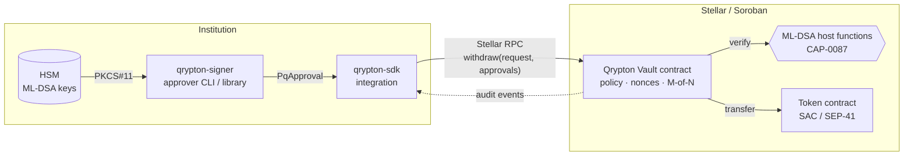
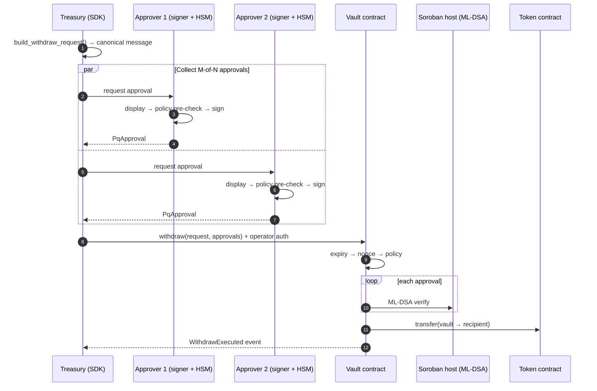

# Qrypton Vault — Post-Quantum Institutional Custody on Stellar

**Qrypton Vault is a Soroban custody vault for anchors and institutions in which no withdrawal executes without ML-DSA (NIST FIPS 204) post-quantum approvals alongside the classical Stellar signature, wrapped in an institutional policy layer: M-of-N approval, withdrawal limits, recipient allowlists, a pre-configured rescue vault, time-locked key and operator rotation, and audit events.**

Why now:

- **The building block is arriving.** Stellar's Quantum Preparedness Plan adds native ML-DSA verification to Soroban as its first stage ([CAP-0087](https://github.com/stellar/stellar-protocol/blob/master/core/cap-0087.md), Protocol 30). What it does not provide is a custody product institutions can deploy as-is.
- **Resource estimates keep falling.** 2026 papers put a break of 256-bit elliptic-curve keys at roughly 1,200 logical qubits ([details below](#the-quantum-threat-in-numbers)).
- **Regulators have set dates.** NIST, the US government and the EU all target 2030–2035 for moving away from quantum-vulnerable public-key cryptography, starting with high-risk systems.

> **Status: Pre-alpha. Architecture and interfaces defined; implementation in progress.**

---

## The quantum threat, in numbers

**What breaks.** A cryptographically relevant quantum computer (CRQC) running Shor's algorithm solves factoring and discrete logarithms efficiently. NIST's draft transition report lists ECDSA, EdDSA (which includes Ed25519) and RSA as algorithms that "are vulnerable to Shor's Algorithm" ([NIST IR 8547 ipd, §3](https://nvlpubs.nist.gov/nistpubs/ir/2024/NIST.IR.8547.ipd.pdf)). Grover's algorithm gives only a quadratic speed-up against symmetric ciphers and hash functions. NIST notes that larger keys and outputs are enough to preserve their security ([NIST IR 8105](https://nvlpubs.nist.gov/nistpubs/ir/2016/NIST.IR.8105.pdf)). For a blockchain, the signature scheme is the weak point; hashes are not.

**How big a machine.** Recent published estimates for solving the discrete-log problem on 256-bit elliptic curves:

| Source | Estimate |
|---|---|
| Chevignard, Fouque, Schrottenloher (Univ Rennes, Inria, CNRS, IRISA), EUROCRYPT 2026 — [ePrint 2026/280](https://eprint.iacr.org/2026/280) | ~**1,193 logical qubits** for a 256-bit prime-field curve |
| Babbush et al., Google Quantum AI, Mar 2026 — [arXiv:2603.28846](https://arxiv.org/abs/2603.28846), [blog](https://research.google/blog/safeguarding-cryptocurrency-by-disclosing-quantum-vulnerabilities-responsibly/) | secp256k1 with < 1,200 logical qubits (< 90M Toffoli gates) or < 1,450 logical qubits (< 70M Toffoli gates). Executable on **< 500,000 physical superconducting qubits** (10⁻³ error rate) in about **18–23 minutes** |
| Cain et al., Oratomic / Caltech / UC Berkeley, Mar 2026 — [arXiv:2603.28627](https://arxiv.org/abs/2603.28627) (preprint) | Neutral-atom architecture. P-256 with about **26,000 atomic qubits** in about 10 days at a 1 ms cycle time. It reuses the Google circuits, so the two estimates are not independent |

For context, Gidney (2025) estimated RSA-2048 at under one million noisy qubits in under a week ([arXiv:2505.15917](https://arxiv.org/abs/2505.15917)).

These are estimates for machines that do not exist today. They do not say when a CRQC will exist. What they show is a steep drop in the required resources, and that elliptic-curve keys need fewer qubits to break than RSA-2048. Ed25519 uses a curve of the same ~256-bit size class. We are not aware of a published Ed25519-specific estimate and do not claim one.

**"Harvest now, decrypt later" is not the main risk for signatures.** HNDL describes adversaries collecting encrypted traffic today in order to decrypt it later. NIST's draft points out the difference for authentication: a signature system "remains secure as long as the cryptographic algorithms and keys used to perform the authentication are secure when the authentication is performed" ([NIST IR 8547 ipd](https://nvlpubs.nist.gov/nistpubs/ir/2024/NIST.IR.8547.ipd.pdf)). Past signatures do not need to be forged. The risk is forward-looking: once a CRQC exists, any public key that still controls funds can be turned into its private key and used to sign *new* transactions. For custody, the deadline is set by when keys must stop being Ed25519-only, not by when data was recorded.

## Why Stellar is especially exposed

A Stellar account address (`G...`) is not a hash. It is the raw 32-byte Ed25519 public key, base32-encoded with a version byte and checksum ([SEP-0023](https://github.com/stellar/stellar-protocol/blob/master/ecosystem/sep-0023.md)). By contrast, an Ethereum address is the last 20 bytes of the Keccak-256 hash of the public key ([ethereum.org](https://ethereum.org/en/developers/docs/accounts/)), and a Bitcoin P2PKH output commits only to a public-key hash until it is spent ([Bitcoin developer guide](https://developer.bitcoin.org/devguide/transactions.html)).

On Stellar, therefore, **every account's public key is already public**, including accounts that have never sent a transaction. There is no "unrevealed key" subset that a CRQC must wait for.

Value at stake, observed 2026-10-25:

- XLM market capitalisation about **$5.94B** ([CoinGecko](https://www.coingecko.com/en/coins/stellar)).
- About **384M USDC** issued on Stellar ([StellarExpert, issued supply](https://stellar.expert/explorer/public/asset/USDC-GA5ZSEJYB37JRC5AVCIA5MOP4RHTM335X2KGX3IHOJAPP5RE34K4KZVN)).
- **$3.75B** "distributed asset value" of tokenized real-world assets on Stellar, according to rwa.xyz ([rwa.xyz](https://app.rwa.xyz/networks/stellar)).

## The regulatory clock

| Milestone | What it says |
|---|---|
| **NIST FIPS 203 / 204 / 205** — final, 13 Aug 2024 ([NIST](https://www.nist.gov/news-events/news/2024/08/nist-releases-first-3-finalized-post-quantum-encryption-standards)) | ML-KEM, **ML-DSA** and SLH-DSA standardised |
| **NIST IR 8547** — initial public draft, Nov 2024 ([CSRC](https://csrc.nist.gov/pubs/ir/8547/ipd)) | Proposes that quantum-vulnerable algorithms at 112-bit security be **deprecated after 2030**, and all quantum-vulnerable algorithms, including 128-bit-security ECDSA/EdDSA, be **disallowed after 2035**. Still a draft |
| **US NSM-10** — 4 May 2022 ([White House archive](https://bidenwhitehouse.archives.gov/briefing-room/statements-releases/2022/05/04/national-security-memorandum-on-promoting-united-states-leadership-in-quantum-computing-while-mitigating-risks-to-vulnerable-cryptographic-systems/)) | Goal of "mitigating as much of the quantum risk as is feasible by 2035" |
| **NSA CNSA 2.0** — Sept 2022 ([advisory](https://media.defense.gov/2025/May/30/2003728741/-1/-1/0/CSA_CNSA_2.0_ALGORITHMS.PDF)) | National security systems: software/firmware signing to prefer CNSA 2.0 by 2025 and use it exclusively by 2030; most other categories exclusive by 2033; transition complete by 2035 |
| **EU Coordinated Implementation Roadmap** — June 2025 ([European Commission](https://digital-strategy.ec.europa.eu/en/library/coordinated-implementation-roadmap-transition-post-quantum-cryptography)) | Member States complete first steps **by end of 2026**; high-risk use cases transitioned **no later than end of 2030**; as many systems as practically feasible **by 2035** |

Custody of financial assets is likely to fall into the high-risk category for most institutions. Their procurement cycles are years long, so the custody stack they will use in 2030 needs to exist and be independently reviewed well before then.

## Stellar's Quantum Preparedness Plan

In June 2026 the Stellar Development Foundation published a three-stage [Quantum Preparedness Plan](https://stellar.org/blog/foundation-news/introducing-the-quantum-preparedness-plan):

- **Stage 1 (2026): post-quantum verification in Soroban.** ML-DSA verification is added as native host functions. Contract accounts can then use quantum-safe signing through account abstraction. The specification is [CAP-0087](https://github.com/stellar/stellar-protocol/blob/master/core/cap-0087.md), which covers ML-DSA-44, -65 and -87 and ships in Protocol 30. At the time of writing, Protocol 30 is released in Stellar Core, and its [testnet and mainnet upgrade votes](https://stellar.org/blog/developers/bell-protocol-30-upgrade-guide) are scheduled for November 2026.
- **Stage 2 (2027): PQ signers on classic accounts.** Quantum-safe signer types become first-class signers on existing `G...` accounts, with no address change.
- **Stage 3 (timing driven by the threat): deprecation.** Ed25519 stops being accepted for new transaction authorization. Timing depends on quantum progress and ecosystem readiness.

**How Qrypton Vault fits.** Qrypton Vault does not compete with these building blocks; it is built on them. Stage 1 supplies a verification primitive, and Qrypton Vault turns it into something an institution can operate: a vault contract with a policy engine, an approver tool that works with HSMs, an integration SDK, and reference flows for anchors.

As far as we know, no custody product institutions can use directly on Stellar yet combines PQ approvals with institutional controls. Qrypton Vault aims to be that product. When Stage 2 lands, the vault's classical `operator` account can itself carry a PQ signer, so the second factor becomes post-quantum as well. By Stage 3, assets held in the vault are already behind ML-DSA.

## What Qrypton Vault does

| Component | Role |
|---|---|
| **Vault contract** (`contracts/vault`) | Holds assets on Soroban. Each withdrawal requires the operator's classical authorization **and** ML-DSA approvals from M of N registered signers over a canonical, domain-separated message. It checks expiry, single-use nonces and the policy before any transfer, and emits an audit event for every state change. |
| **Policy layer** | Per-token per-withdrawal limits, recipient allowlist (closed by default), a pre-configured rescue vault, and time-locked signer-set rotation and operator change. Policy changes that loosen controls (higher limits, new recipients, a different rescue vault) are time-locked; tightening applies immediately. A rolling-window (e.g. daily) limit is planned for the next phase. Policy changes require both the operator and the PQ quorum. |
| **Signer** (`crates/qrypton-signer`) | Approver library and CLI. It decodes and displays the request, pre-checks it against the policy, signs with ML-DSA-65 (default) or ML-DSA-87, and outputs an approval. Key backends: software keystore for development, PKCS#11 HSM for production. |
| **SDK** (`crates/qrypton-sdk`) | Builds requests, collects M-of-N approvals, submits through Stellar RPC and follows vault events. |

**Flow in brief.** The treasury team builds a withdrawal request with the SDK. Approvers each review it in `qrypton-signer` and sign it on their HSM. Once M approvals are collected, the SDK submits the withdrawal with the operator's classical signature. The contract verifies everything and transfers the funds, and the institution's back office reconciles from the emitted events.

### Authority model

- **The PQ quorum is the root of authority.** At least M of the N registered ML-DSA signers must approve every withdrawal and every governance action.
- **The operator is a second factor for day-to-day withdrawals.** It is a classical Stellar account (which can be a multisig account) that must co-authorize withdrawals, policy changes and key rotations.
- **A stolen operator key cannot move anything.** Without the quorum it can neither withdraw nor change settings, and it cannot block recovery.
- **A stolen quorum can replace the operator only after a public waiting period.** Changing the operator needs **only** the M-of-N ML-DSA quorum, never the operator's own signature, so a lost or compromised classical key cannot lock the vault. The change is proposed, waits out a time lock visible to everyone on-chain, and is then executed; only the quorum can cancel it.

**Pre-configured rescue vault.** The time lock on its own only buys time to notice an attack; it does not stop an attacker who holds the quorum. Its real value comes with the rescue vault. When keys have been copied rather than lost, the institution still holds both the operator key and the quorum. During the waiting period it can move all funds to a rescue vault that was configured in the policy in advance. The rescue vault must be controlled by a **separate** quorum and operator, preferably on a separate HSM; if it shared the main vault's keys, an attacker who copied them could reach the rescue vault too. Withdrawals to the rescue vault skip amount limits and the allowlist, but still need the operator and the quorum. Because policy changes need the operator, an attacker holding only the quorum cannot remove the rescue vault; and because changing the rescue vault counts as loosening, even an attacker holding both cannot swap it without a public waiting period. The same path replaces upgrades: the contract has **no upgrade entry point**, and migrating to a new version means withdrawing to a new vault under the normal rules.

The contract never implements ML-DSA; verification is delegated to the Soroban host behind a `PqVerifier` trait. The off-chain components do not implement ML-DSA either: in production, signing happens in HSM firmware; in development, it uses an established open-source Rust ML-DSA library that has not yet been independently audited.

## Architecture



A single withdrawal:



More detail: [docs/architecture.md](docs/architecture.md) · [docs/threat-model.md](docs/threat-model.md).

## Who it is for

- **Anchors.** Keep fiat-backed reserves in a vault so that moving reserve funds to operational wallets needs approvals from treasury, compliance and risk, within per-withdrawal limits (daily limits follow in the next phase) and only to allowlisted wallets.
- **Corporate treasuries.** Run on-chain treasury wallets under the same maker-checker, limit and audit controls the institution applies to bank payments, with post-quantum keys from day one.
- **RWA issuers.** Hold redemption and distribution pools for tokenized funds or bonds so that outflows need M-of-N PQ approval, and each one is recorded as an event for the fund administrator.
- **Custody providers.** Offer clients a post-quantum custody option on Stellar built on HSM infrastructure they already operate, without each client building its own contracts.

## Roadmap

Each milestone ends in a measurable, public deliverable. See [docs/roadmap.md](docs/roadmap.md).

The first 30-day phase covers M1 and M2 plus the core policy layer (per-withdrawal limit, default-closed allowlist, pre-configured rescue vault, and the shared time lock for key rotation, operator change and policy loosening); M3 and M4 follow.

**Dependency:** M1 depends on Protocol 30 reaching testnet (validator vote scheduled for 3 November 2026) and on the release of stellar-cli 30. Until then, contract logic is developed against a mock verifier.

| | Milestone | Done when |
|---|---|---|
| **M1** | Vault contract and native ML-DSA verification | A withdrawal approved with ML-DSA-65 executes on testnet using the CAP-0087 host functions. The repo publishes measured CPU instructions, memory and fees for 1, 2 and 3 approvals (1-of-1, 2-of-3, 3-of-5) for ML-DSA-44/65/87. |
| **M2** | Signer, software keystore, M-of-N, governance | `qrypton-signer` generates keys, displays and approves requests, and an M-of-N testnet withdrawal succeeds with independent approvers. Policy changes (loosening time-locked, tightening immediate), time-locked key rotation and operator change, and rescue-vault withdrawals work on testnet. The negative cases are tested: duplicate signer, wrong network, wrong vault, expired request, reused nonce, quorum approval without the operator, operator authorization without the quorum, loosening executed before its time lock, and a stale cancel approval used against a newer proposal. |
| **M3** | SDK and anchor demo | The anchor-reserve scenario in `examples/` runs end-to-end on testnet through `qrypton-sdk`, including event-based reconciliation. A recorded demo and an integration guide are published. |
| **M4** | PKCS#11 HSM and independent review | ML-DSA signing runs inside an HSM through PKCS#11. An independent security review of the contract and signer is completed, and the findings and fixes are published. |

**Next phase:** a rolling-window (e.g. daily) withdrawal limit, with withdrawals to the rescue vault exempt.

## Team

Ömer Salih Deniz — backend engineer with five years at crypto exchanges and blockchain companies: custody integrations, an in-house custody stack (HSM key storage, signer, policy rules) and 20+ blockchain integrations. Stellar Ambassador (Türkiye).

## Status

Pre-alpha. Architecture and interfaces defined; implementation in progress.

The workspace builds (`cargo check --workspace`, `stellar contract build`), but function bodies are `todo!()` and tests are skeletons marked `#[ignore]`. Do not use this code to hold assets.

```
contracts/vault/          Soroban vault contract (qrypton-vault-contract)
crates/qrypton-types/     Shared types and canonical message format
crates/qrypton-signer/    Approver library + `qrypton-signer` CLI
crates/qrypton-sdk/       Integration SDK
examples/                 Anchor reserve withdrawal scenario (skeleton)
docs/                     Architecture, threat model, roadmap
```

---

Copyright © 2026 Ömer Salih Deniz. All rights reserved.  
This repository is shared for evaluation purposes only; no license is granted to use, copy, modify or distribute this code.
