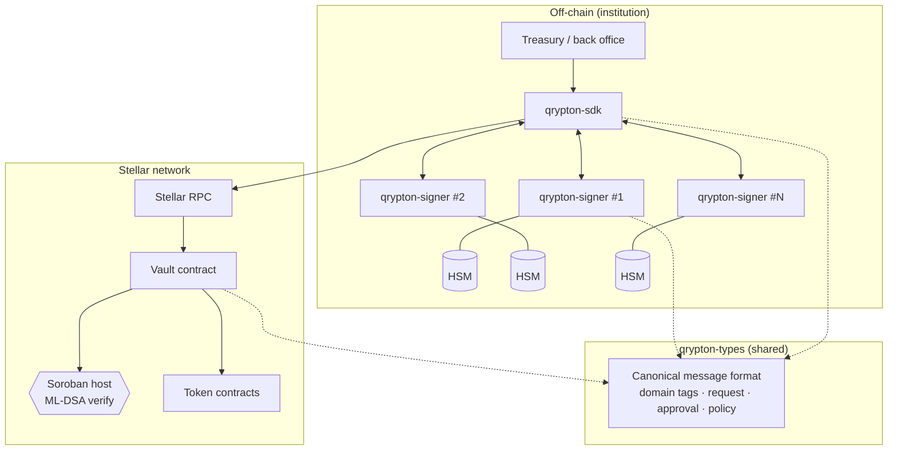
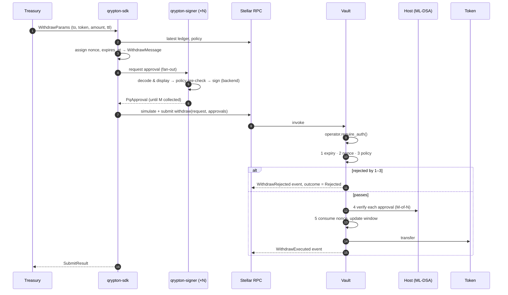
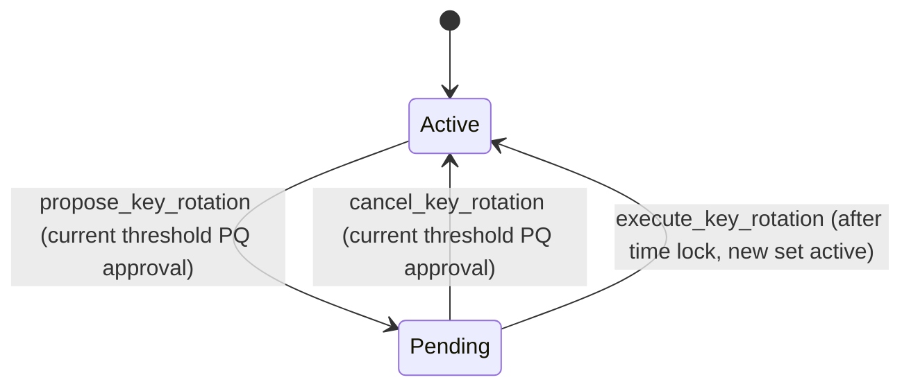

# Architecture

This document describes Qrypton Vault at the level of components, trust boundaries and flows. Interfaces are defined in code; internal parameters (policy evaluation details, rotation time-lock values, HSM integration specifics) are intentionally not documented here.

## Components



| Component | Responsibility | Does **not** do |
|---|---|---|
| `qrypton-types` | Algorithm identifiers and sizes, canonical signed-message format, off-chain request/approval/policy types. `no_std`, shared with the contract. | Cryptography, I/O |
| Vault contract | Custody of assets; classical + PQ authorization; expiry, nonce and policy enforcement; signer-set and policy governance; audit events. | Implement ML-DSA (delegated to the host) |
| `qrypton-signer` | Hold one approver's key (via a backend), show the request, pre-check policy, sign, output a `PqApproval`. CLI: `keygen`, `show-pubkey`, `approve-withdraw`. | Submit transactions; decide policy |
| `qrypton-sdk` | Build requests, collect M-of-N approvals, submit via Stellar RPC, stream events. | Hold PQ keys |

## Authorization model

A withdrawal needs two independent authorizations:

1. **Classical** — the vault's `operator` address authorizes the invocation (`require_auth`). The operator can be a Stellar multisig account or a contract account. Once Stage 2 of Stellar's Quantum Preparedness Plan adds PQ signers to classic accounts, this layer can itself become post-quantum.
2. **Post-quantum** — at least `threshold` distinct signers from the vault's registered ML-DSA signer set approve the canonical message.

Neither layer alone can move funds. Compromise of the classical key (including by a future CRQC) is not sufficient; compromise of fewer than `threshold` PQ keys is not sufficient.

Governance actions (policy change, signer-set rotation, rotation cancellation) use the same two layers, each with its own domain tag.

## Signed message

Approvers sign a canonical byte string defined in `crates/qrypton-types/src/message.rs`:

```
len(tag) || "qrypton-vault/withdraw/v1"
network_id            (SHA-256 of the network passphrase)
vault address
to address
token address
amount                (i128, big-endian)
nonce                 (u64, big-endian)
expires_at            (u64, big-endian, ledger timestamp)
```

Address fields are length-prefixed XDR. The contract rebuilds this message from the request; it never accepts a caller-supplied message. Binding the network, the vault and a versioned domain tag prevents cross-network, cross-vault and cross-action replay; the nonce prevents replay within a vault.

## Withdrawal flow



Validation is ordered from cheapest to most expensive so that requests failing simple checks never pay for signature verification. Because Soroban rolls back all effects of a failed invocation (including events), policy-level rejections are returned as a non-reverting `Rejected` outcome so they leave an audit record; an invalid ML-DSA signature traps and fails the transaction.

## Signer-set rotation



The time lock gives the institution a window to notice and cancel an unauthorized rotation. Its duration is a deployment parameter.

## ML-DSA verification

The contract calls ML-DSA only through the `PqVerifier` trait:

- `NativeHostVerifier` — uses the Soroban host functions specified in [CAP-0087](https://github.com/stellar/stellar-protocol/blob/master/core/cap-0087.md) (Protocol 30). The host traps on invalid signatures. The binding is written once the Protocol 30 SDK and tooling are stable.
- `MockVerifier` — compiled only in unit tests, to exercise thresholds, duplicates and mismatches.

ML-DSA-65 is the default parameter set; ML-DSA-87 is supported for NIST category 5. Pure ML-DSA (not HashML-DSA) with an empty FIPS 204 context is used; domain separation lives in the message.

## Events

| Event | Emitted when |
|---|---|
| `Deposited` | Funds enter the vault |
| `WithdrawExecuted` | A withdrawal transfers funds (includes the signer indices counted) |
| `WithdrawRejected` | A withdrawal is refused by expiry, nonce or policy |
| `KeyRotationProposed` / `KeyRotationExecuted` / `KeyRotationCancelled` | Signer-set governance |
| `PolicyUpdated` | Policy replaced (carries the policy hash) |

Events are designed so the vault's state can be reconciled from the event stream alone.
