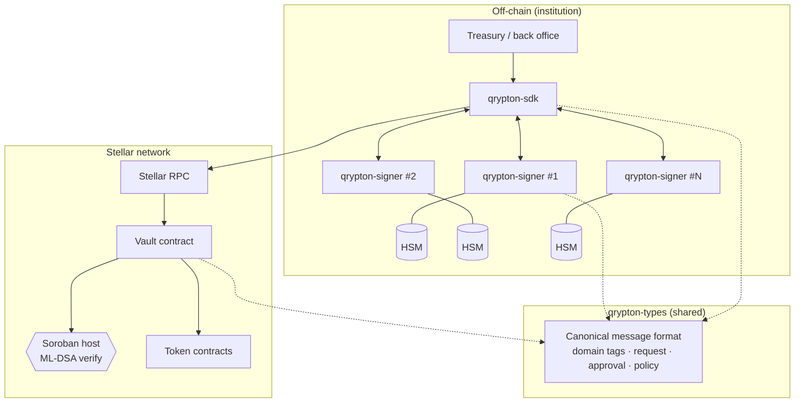
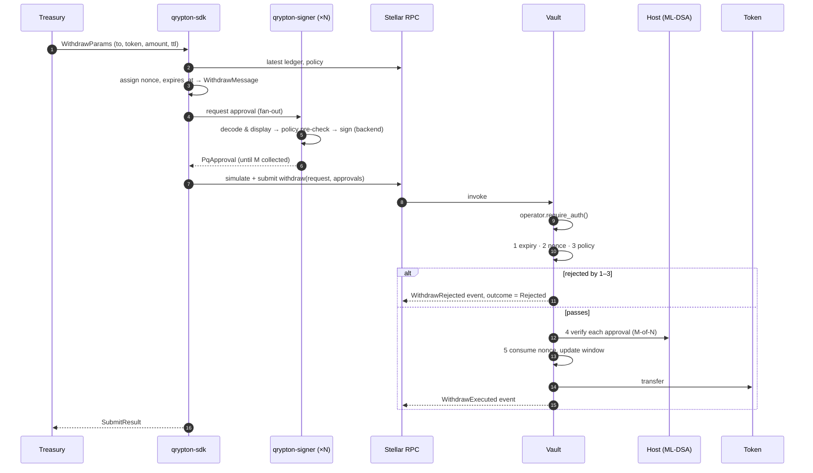
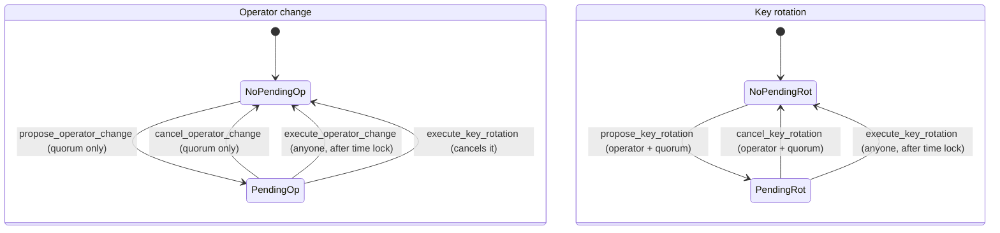

# Architecture

This document describes Qrypton Vault at the level of components, trust boundaries and flows. Interfaces are defined in code; internal parameters (policy evaluation details, rotation time-lock values, HSM integration specifics) are intentionally not documented here.

## Components



| Component | Responsibility | Does **not** do |
|---|---|---|
| `qrypton-types` | Algorithm identifiers and sizes, canonical signed-message format, off-chain request/approval/policy types. `no_std`, shared with the contract. | Cryptography, I/O |
| Vault contract | Custody of assets; PQ quorum + operator authorization; expiry, nonce and policy enforcement; signer-set, operator and policy governance; audit events. | Implement ML-DSA (delegated to the host) |
| `qrypton-signer` | Hold one approver's key (via a backend), show the request, pre-check policy, sign, output a `PqApproval`. CLI: `keygen`, `show-pubkey`, `approve-withdraw`. | Submit transactions; decide policy |
| `qrypton-sdk` | Build requests, collect M-of-N approvals, submit via Stellar RPC, stream events. | Hold PQ keys |

## Authority model

- **PQ quorum — root of authority.** At least `threshold` distinct signers from the vault's registered ML-DSA signer set must approve every withdrawal and every governance action.
- **Operator — second factor for day-to-day withdrawals.** The vault's `operator` is a classical Stellar address that authorizes the invocation (`require_auth`); it can be a multisig account or a contract account. Once Stage 2 of Stellar's Quantum Preparedness Plan adds PQ signers to classic accounts, the operator can itself become post-quantum.
- **A stolen operator key cannot move anything** and cannot block recovery.
- **A stolen quorum can replace the operator only after a public time lock.** Changing the operator requires **only** the PQ quorum, never the operator's own signature, so a broken or lost classical key cannot lock the vault.

| Action | Operator | PQ quorum | Time lock | Domain tag |
|---|:-:|:-:|:-:|---|
| `withdraw` | ✓ | ✓ | | `withdraw/v1` |
| `set_policy` | ✓ | ✓ | | `set-policy/v1` |
| `propose_key_rotation` | ✓ | ✓ | ✓ | `rotate-keys/v1` |
| `cancel_key_rotation` | ✓ | ✓ | | `cancel-key-rotation/v1` |
| `propose_operator_change` | | ✓ | ✓ | `set-operator/v1` |
| `cancel_operator_change` | | ✓ | | `cancel-operator-change/v1` |
| `execute_key_rotation`, `execute_operator_change` | anyone, after the time lock | | | |

`set_policy` deliberately requires the operator: an attacker holding only the quorum cannot remove the rescue vault or change limits while an operator change is pending.

### Rescue vault

The policy names a pre-allowlisted **rescue vault**, typically another Qrypton Vault held by the same institution. Withdrawals to it still need the operator and the quorum, but skip amount limits and the allowlist, so all funds can be moved in one step. Any future rolling-window limit must exempt it as well.

A time lock alone only gives time to notice an attack. The rescue vault turns that time into a response: if keys were copied rather than lost, the institution still holds the operator key and the quorum and can move funds to the rescue vault before the attacker's operator change executes.

### No upgrade entry point

The contract has no upgrade function in the current phase; its code cannot be replaced after deployment. Migrating to a new version uses the same path as a rescue: withdraw to a new vault under the normal authorization rules.

## Signed message

Approvers sign a canonical byte string defined in `crates/qrypton-types/src/message.rs`:

```
len(tag) || "qrypton-vault/withdraw/v1"
network_id            (SHA-256 of the network passphrase)
vault address
to address
token address
amount                (i128, big-endian)
nonce                 (u64, big-endian)
expires_at            (u64, big-endian, ledger timestamp)
```

Governance messages use the same envelope (tag, network id, vault, action payload, nonce, expiry) with their own domain tag per action; cancellations commit to the hash of the specific pending proposal. Nonces are single-use across all actions of a vault.

Address fields are length-prefixed XDR. The contract rebuilds this message from the request; it never accepts a caller-supplied message. Binding the network, the vault and a versioned domain tag prevents cross-network, cross-vault and cross-action replay; the nonce prevents replay within a vault.

## Withdrawal flow



Validation is ordered from cheapest to most expensive so that requests failing simple checks never pay for signature verification. Because Soroban rolls back all effects of a failed invocation (including events), policy-level rejections are returned as a non-reverting `Rejected` outcome so they leave an audit record; an invalid ML-DSA signature traps and fails the transaction.

## Time-locked governance

Signer-set rotation and operator change follow the same pattern: **propose → wait → execute**. At most one of each can be pending. Execution is permissionless once the time lock has passed, because the change was already approved when it was proposed.



Executing a key rotation cancels any pending operator change. That proposal was approved by the old signer set, and keys removed by the rotation must not be able to complete a change afterwards.

The time-lock durations are deployment parameters.

## ML-DSA verification

The contract calls ML-DSA only through the `PqVerifier` trait:

- `NativeHostVerifier` — uses the Soroban host functions specified in [CAP-0087](https://github.com/stellar/stellar-protocol/blob/master/core/cap-0087.md) (Protocol 30). The host traps on invalid signatures. The binding is written once the Protocol 30 SDK and tooling are stable.
- `MockVerifier` — compiled only in unit tests, to exercise thresholds, duplicates and mismatches.

ML-DSA-65 is the default parameter set; ML-DSA-87 is supported for NIST category 5. Pure ML-DSA (not HashML-DSA) with an empty FIPS 204 context is used; domain separation lives in the message.

## Events

| Event | Emitted when |
|---|---|
| `Deposited` | Funds enter the vault |
| `WithdrawExecuted` | A withdrawal transfers funds (includes the signer indices counted) |
| `WithdrawRejected` | A withdrawal is refused by expiry, nonce or policy |
| `KeyRotationProposed` / `KeyRotationExecuted` / `KeyRotationCancelled` | Signer-set governance |
| `OperatorChangeProposed` / `OperatorChangeExecuted` / `OperatorChangeCancelled` | Operator governance (cancellation records whether the quorum or a key rotation caused it) |
| `PolicyUpdated` | Policy replaced (carries the policy hash) |

Events are designed so the vault's state can be reconciled from the event stream alone.
